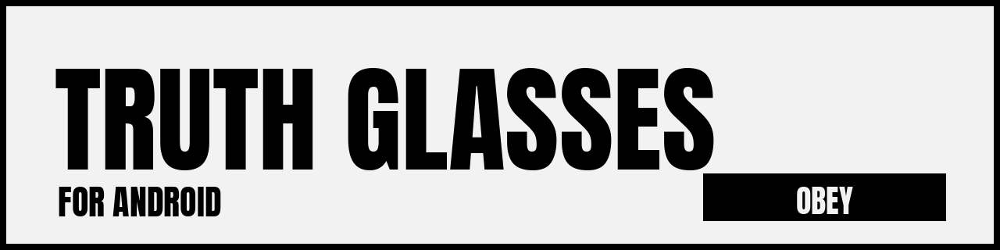
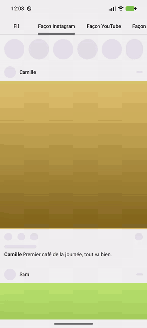
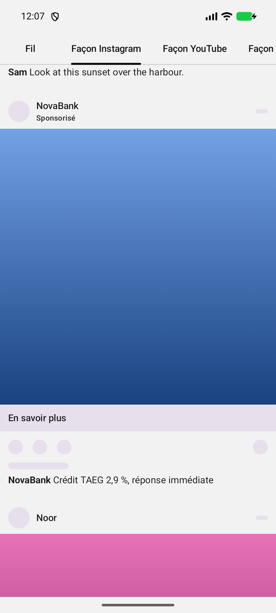
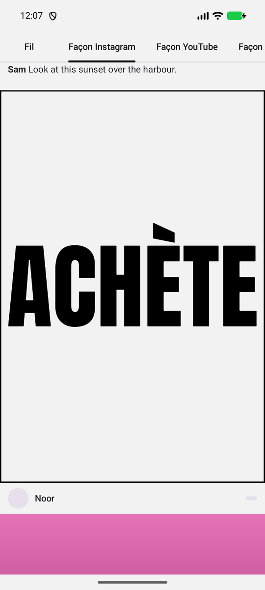
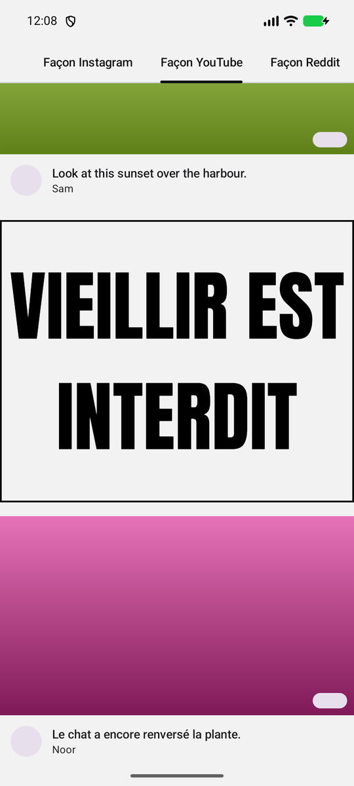
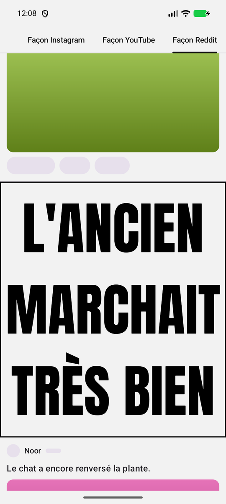
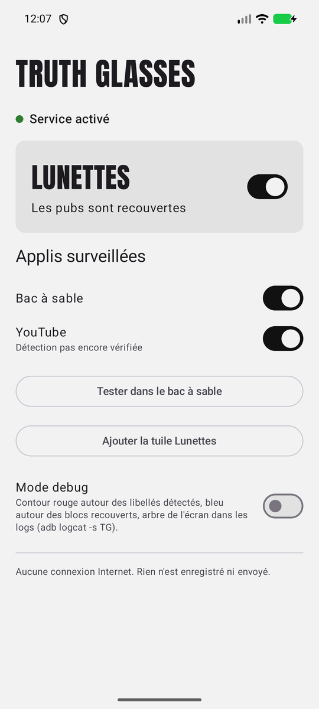

<p align="center">
  
</p>

<p align="center">
  <b>Une appli Android parodique qui recouvre les pubs de vos autres applis par ce qu'elles veulent vraiment dire.</b><br>
  OBÉIS · TU N'EN AS PAS BESOIN · C'EST TOI LE PRODUIT
</p>

<p align="center">
  <a href="README.md">English version</a> ·
  <a href="https://github.com/MZA-code/truth-glasses-android/releases/latest">Télécharger l'APK</a>
</p>

---

<p align="center">
  
</p>

Truth Glasses est la petite sœur de l'extension Chrome **Lunettes de vérité**<!-- TODO: lien vers l'extension Chrome -->. Quand les lunettes sont mises, chaque post sponsorisé repéré dans une appli surveillée est recouvert par un bloc gris clair bordé de noir, avec un message ironique en grosses capitales. Le message dépend du sujet de la pub : crédit, soldes, essai gratuit, beauté, jeux d'argent, voiture, crypto… et un message générique pour tout le reste.

C'est une blague qui a un fond. L'appli ne bloque rien : la pub est toujours là, sous un autocollant qui dit ce qu'elle raconte vraiment.

## Avant / après

<table>
  <tr>
    <th>Sans les lunettes</th>
    <th>Avec les lunettes</th>
  </tr>
  <tr>
    <td></td>
    <td></td>
  </tr>
</table>

Ces captures viennent du **bac à sable** intégré à l'appli : des maquettes squelette qui reprennent la mise en page d'Instagram, de YouTube et de Reddit avec de fausses pubs, pour tout essayer sans les vraies applis.

<table>
  <tr>
    <td></td>
    <td></td>
    <td></td>
  </tr>
</table>

## État du projet

**Version 0.1.0.** La détection, les messages, l'écran d'accueil, la tuile des réglages rapides et le bac à sable fonctionnent.

Pour les vraies applis, le libellé « Sponsorisé » de chacune doit être vérifié à la main avant d'être ajouté : l'appli ne devine jamais. En attendant, Instagram, YouTube et Reddit affichent **« Détection pas encore vérifiée »** sur l'accueil, et rien n'y est recouvert.

## Installation

1. **Téléchargez** `truth-glasses-vX.Y.Z.apk` depuis la [dernière release](https://github.com/MZA-code/truth-glasses-android/releases/latest). Le fichier `.sha256` à côté permet de vérifier le téléchargement : `sha256sum -c truth-glasses-vX.Y.Z.apk.sha256`.
2. **Ouvrez l'APK** sur le téléphone. Android demande d'autoriser l'installation depuis le navigateur ou le gestionnaire de fichiers. Play Protect peut afficher un avertissement, parce que l'appli ne vient pas du Play Store.
3. **Ouvrez Truth Glasses.** L'écran d'accueil guide en trois étapes :
   1. **Android 13 et plus :** ouvrez *Infos sur l'appli*, puis le menu ⋮ → *Autoriser les paramètres restreints*. Sans ça, Android grise le service d'accessibilité des applis installées hors store.
   2. **Activez le service :** touchez *Ouvrir les réglages d'accessibilité* et activez *Truth Glasses*.
   3. **Ajoutez la tuile Lunettes** aux réglages rapides, pour mettre et enlever les lunettes à tout moment.
4. **Essayez** avec *Tester dans le bac à sable*, puis ouvrez une des applis surveillées.

> **Vérification des développeurs Android.** Google impose peu à peu que les applis installées sur les appareils certifiés viennent de développeurs vérifiés : c'est en vigueur dans quelques pays depuis septembre 2026, et annoncé pour le reste du monde à partir de 2027. Si votre téléphone bloque l'installation, vous pouvez passer par le parcours « avancé » d'Android (avec un délai d'attente et des avertissements), ou installer depuis un ordinateur avec `adb install truth-glasses-vX.Y.Z.apk`.

## Vie privée

Un service d'accessibilité peut lire ce qui s'affiche à l'écran : la méfiance est normale. Voici exactement ce que celui-ci fait et ne fait pas.

- **Pas d'Internet.** L'appli n'a pas la permission `INTERNET` : elle ne peut rien envoyer nulle part. Pas de statistiques, pas de pub, pas de télémétrie. Vous pouvez le vérifier : `aapt2 dump permissions truth-glasses-vX.Y.Z.apk`.
- **Seulement les applis que vous choisissez.** Le service ne reçoit que les événements des applis activées sur l'accueil. Le reste lui est invisible.
- **Rien n'est enregistré.** Le texte d'un post est lu pour trouver le libellé « Sponsorisé » et choisir un message adapté, puis oublié. Pour continuer à recouvrir une pub quand son libellé sort de l'écran, l'appli garde en mémoire, brièvement, des hash de ses textes longs (jamais le texte lui-même), oubliés dès qu'on quitte l'appli.
- **Les champs de saisie ne sont jamais lus.** Ce que vous tapez reste hors de portée.
- **L'appli n'agit jamais à votre place.** Pas de toucher, pas de scroll, pas de geste. Elle dessine seulement par-dessus l'écran, et vos touchers traversent jusqu'à l'appli en dessous.
- **Code ouvert.** Chaque ligne est dans ce dépôt, sous licence MIT.

## Limites

- **Seulement les pubs du fil.** Les pubs vidéo en plein écran (pré-roll YouTube, pubs entre les stories Instagram) ne sont pas recouvertes.
- **Les applis changent.** Quand une appli renomme son libellé « Sponsorisé » ou réorganise son affichage, la détection casse jusqu'à la mise à jour du profil. C'est normal.
- **Un léger retard au scroll rapide.** Les blocs suivent le scroll tout de suite, puis sont corrigés au scan suivant de l'écran.
- **Les pubs qui arrivent par le haut.** Une pub jamais vue qui entre par le haut de l'écran reste découverte jusqu'à l'apparition de son libellé.

## Compiler soi-même

Il faut le JDK 21 et le SDK Android (API 37).

```bash
./gradlew testDebugUnitTest assembleDebug   # APK dans app/build/outputs/apk/debug/
adb install -r app/build/outputs/apk/debug/app-debug.apk
```

La spécification complète est dans [`docs/SPEC.md`](docs/SPEC.md) et la liste des tests manuels dans [`docs/TESTING.md`](docs/TESTING.md).

## Aider à vérifier une appli

Si une pub n'est pas recouverte, activez le **Mode debug** sur l'accueil : les libellés détectés sont entourés en rouge et les blocs recouverts en bleu. Avec un build debug, `adb logcat -s TG` affiche la structure de l'écran. Ouvrez ensuite une issue avec le libellé exact et sa position (par exemple « Sponsorisé, sous le pseudo »). Merci de ne pas coller de dump d'écran : il contient votre fil.

## Licence

[MIT](LICENSE). La police Anton est sous [SIL Open Font License](app/src/main/assets/licenses/Anton-OFL.txt).

**Projet parodique.** Truth Glasses n'a aucun lien avec Instagram, YouTube, Reddit, Meta ou Google. Leurs noms servent seulement à dire quelles applis les maquettes imitent et où les lunettes fonctionnent.
