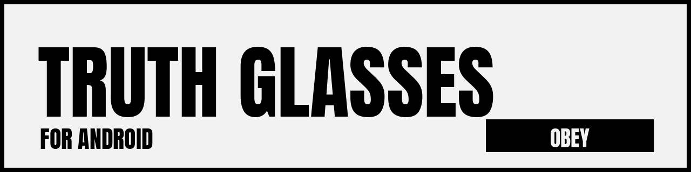
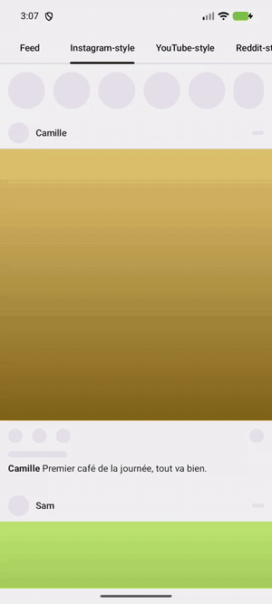
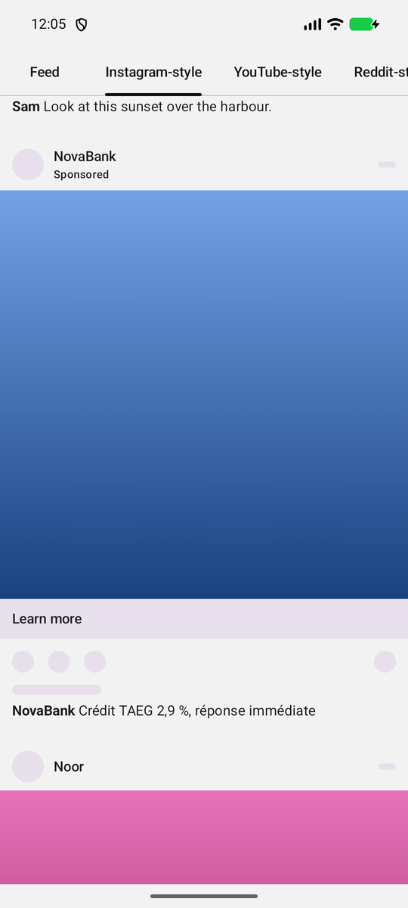
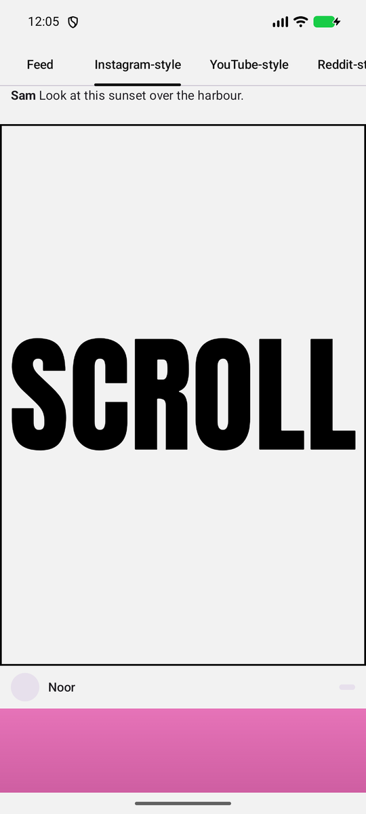
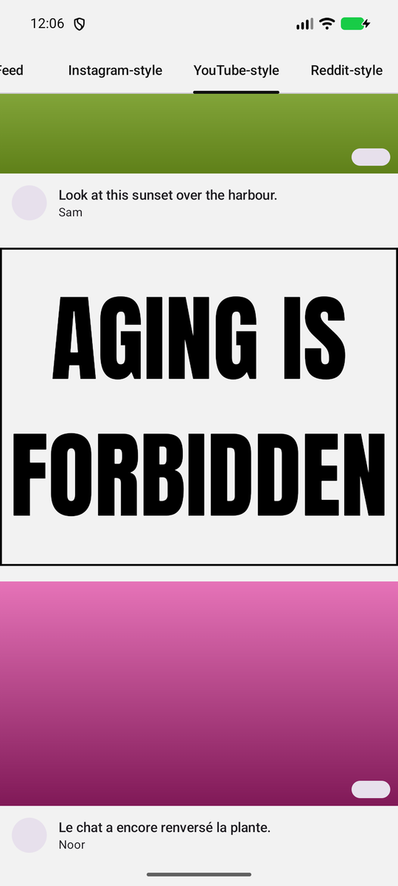
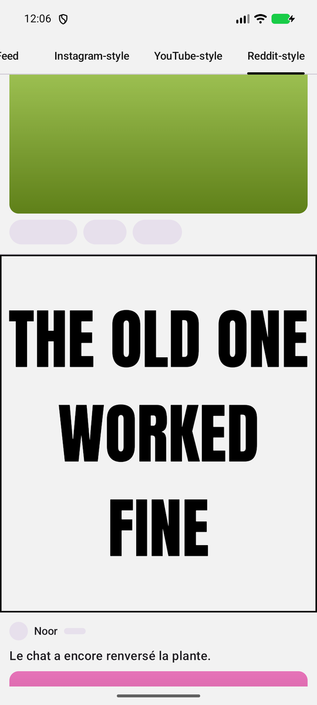
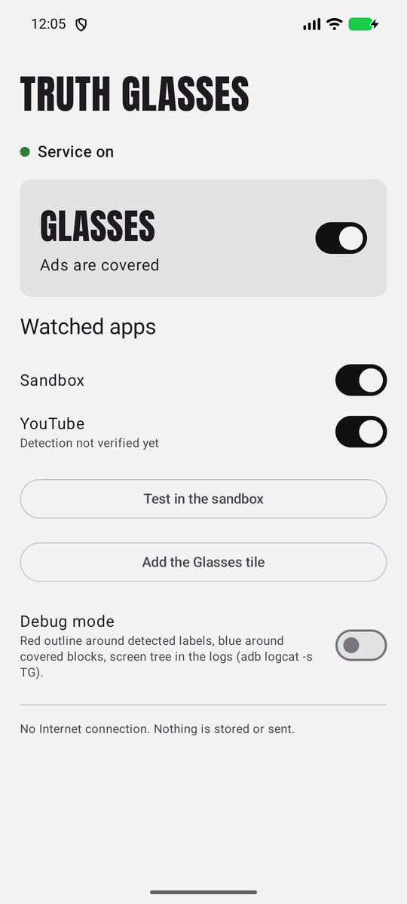

<p align="center">
  
</p>

<p align="center">
  <b>A parody Android app that covers ads in your other apps with what they really mean.</b><br>
  OBEY · YOU DON'T NEED IT · YOU ARE THE PRODUCT
</p>

<p align="center">
  <a href="README.fr.md">Version française</a> ·
  <a href="https://github.com/MZA-code/truth-glasses-android/releases/latest">Download the APK</a>
</p>

---

<p align="center">
  
</p>

Truth Glasses is the little sibling of the **Truth Glasses** Chrome extension<!-- TODO: lien vers l'extension Chrome -->. When the glasses are on, every sponsored post it spots in a watched app is covered by a light grey block with a black border and an ironic message in big capitals. The message depends on what the ad is about: credit, sales, free trials, beauty, gambling, cars, crypto… and a generic one for everything else.

It's a joke with a point. It doesn't block anything: the ad is still there, under a sticker that tells you what it's really saying.

## Before / after

<table>
  <tr>
    <th>Glasses off</th>
    <th>Glasses on</th>
  </tr>
  <tr>
    <td></td>
    <td></td>
  </tr>
</table>

These screenshots come from the **sandbox** built into the app: skeleton mockups that reproduce the layout of Instagram, YouTube and Reddit with fake ads, so you can try everything without the real apps.

<table>
  <tr>
    <td></td>
    <td></td>
    <td></td>
  </tr>
</table>

## Status

**Version 0.1.0.** Detection, messages, the home screen, the quick settings tile and the sandbox work.

For the real apps, the "Sponsored" label each one shows must be checked by hand before it's added: the app never guesses. Until that's done, Instagram, YouTube and Reddit show **"Detection not verified yet"** on the home screen and nothing is covered in them.

## Install

1. **Download** `truth-glasses-vX.Y.Z.apk` from the [latest release](https://github.com/MZA-code/truth-glasses-android/releases/latest). The `.sha256` file next to it lets you check the download: `sha256sum -c truth-glasses-vX.Y.Z.apk.sha256`.
2. **Open the APK** on your phone. Android asks you to allow installs from your browser or file manager. Play Protect may show a warning, because the app doesn't come from the Play Store.
3. **Open Truth Glasses.** The home screen walks you through three steps:
   1. **Android 13 and later:** open *App info*, then the ⋮ menu → *Allow restricted settings*. Without this, Android greys out the accessibility service of apps installed outside a store.
   2. **Turn on the service:** tap *Open accessibility settings* and enable *Truth Glasses*.
   3. **Add the Glasses tile** to quick settings, to put the glasses on and off at any time.
4. **Try it** with *Test in the sandbox*, then open one of the watched apps.

> **Android developer verification.** Google is rolling out a requirement for apps on certified devices to come from verified developers: enforced in some countries since September 2026, and announced for the rest of the world from 2027. If your phone blocks the install, you can use Android's "advanced" sideloading flow (it adds a waiting period and warnings), or install from a computer with `adb install truth-glasses-vX.Y.Z.apk`.

## Privacy

An accessibility service can read what's on your screen, so it deserves suspicion. Here is exactly what this one does and doesn't do.

- **No Internet.** The app doesn't have the `INTERNET` permission, so it can't send anything anywhere. No analytics, no ads, no telemetry. You can check it yourself: `aapt2 dump permissions truth-glasses-vX.Y.Z.apk`.
- **Only the apps you choose.** The service only receives events from the apps switched on in the home screen. Everything else is invisible to it.
- **Nothing is stored.** The text of a post is read to find the "Sponsored" label and pick a matching message, then dropped. To keep covering an ad after its label scrolls off screen, the app keeps short-lived hashes of its long texts in memory (never the text itself), forgotten when you leave the app.
- **Input fields are never read.** What you type stays out of the app's reach.
- **It never acts for you.** No taps, no scrolling, no gestures. It only draws on top of the screen, and your touches go straight through to the app underneath.
- **Open source.** Every line is in this repository, under the MIT license.

## Limits

- **Feed ads only.** Full-screen video ads (YouTube pre-rolls, ads between Instagram stories) aren't covered.
- **Apps change.** When an app renames its "Sponsored" label or reshuffles its layout, detection breaks until the profile is updated. That's expected.
- **A small delay on fast scrolls.** The covers follow the scroll right away, then get corrected by the next screen scan.
- **Ads coming in from the top.** An ad never seen before that scrolls in from the top stays uncovered until its label shows up.

## Build from source

You need JDK 21 and the Android SDK (API 37).

```bash
./gradlew testDebugUnitTest assembleDebug   # APK in app/build/outputs/apk/debug/
adb install -r app/build/outputs/apk/debug/app-debug.apk
```

The full specification is in [`docs/SPEC.md`](docs/SPEC.md) (in French) and the manual test list in [`docs/TESTING.md`](docs/TESTING.md).

## Help check an app

If you see an ad that isn't covered, turn on **Debug mode** on the home screen. Detected labels get a red outline and covered blocks a blue one. With a debug build, `adb logcat -s TG` prints the structure of the screen. Then open an issue with the exact label you see and where it sits (for example "Sponsored, under the username"). Please don't paste screen dumps: they contain your feed.

## License

[MIT](LICENSE). The Anton font is under the [SIL Open Font License](app/src/main/assets/licenses/Anton-OFL.txt).

**A parody project.** Truth Glasses isn't affiliated with Instagram, YouTube, Reddit, Meta or Google. Their names only describe which apps the mockups imitate and where the glasses work.
